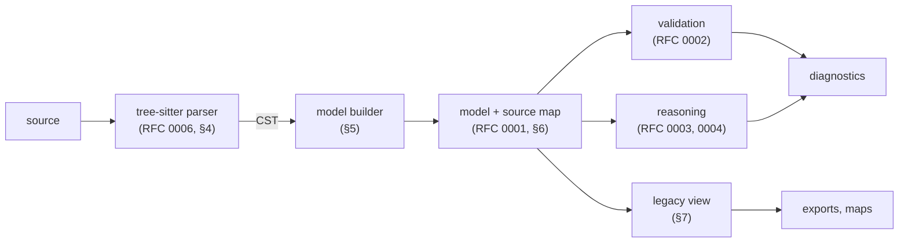

# RFC 0007: Argdown Parser Architecture

| | |
|---|---|
| **RFC** | 0007 |
| **Title** | Argdown Parser Architecture |
| **Status** | Draft |
| **Authors** | Lucas Wiese |
| **Created** | 2026-11-11 |
| **Related** | RFC 0006 (syntax), RFC 0001 (data model), RFC 0002 (validation), RFC 0003 (dialectical grounding), RFC 0004 (classical semantics) |

## 1. Summary

This RFC specifies how Argdown 3.0 turns source text into the data model of RFC 0001. It has three parts:

- **Reference parser.** A tree-sitter grammar that implements RFC 0006 and runs in Node.js and in browsers (§4).
- **Model builder.** The normative mapping from the syntax tree to the entities of RFC 0001 (§5). This is the parser's decision that RFC 0001, P2 leaves open.
- **Plugin pipeline.** The TypeScript plugin architecture of Argdown 2.x, adapted to the new tree and model, with a compatibility layer for existing plugins and exports (§7, §8).

## 2. Motivation

Argdown 2.x processes a document in one pipeline inside `@argdown/core`:

- the Chevrotain lexer and parser (`lexer.ts`, `parser.ts`);
- a tree walker (`ArgdownTreeWalker.ts`);
- plugins that react to tree nodes, most importantly `ModelPlugin.ts`.

That pipeline has four weaknesses:

- **Model building is mixed with interpretation.** `ModelPlugin` builds equivalence classes, assigns pcs to arguments, applies strict or loose mode, and transforms argument relations, all in one pass. RFC 0001 separates asserted content from derived content. The pipeline has to do the same.
- **The syntax is implemented several times.** Besides the parser, there are separate highlighters for CodeMirror (`argdown-codemirror-mode`), highlight.js (`argdown-highlightjs`) and VS Code (a TextMate grammar), each with its own approximation of the syntax.
- **No incremental parsing.** The language server reparses the whole document on every keystroke.
- **Errors stop processing.** Chevrotain's error recovery is limited, and a syntax error often loses most of the document's model.

## 3. Overview



Each arrow is a processor in the plugin pipeline (§8). Each stage depends only on the outputs of earlier stages.

## 4. Reference parser

### 4.1 tree-sitter

The reference parser is a tree-sitter grammar, published as the npm package `@argdown/tree-sitter`. It contains:

- `grammar.js`: **generated** from the EBNF of RFC 0006 (§4.5), with one rule per production of RFC 0006 §5 and §7 and the same names. It MUST NOT be edited by hand. Tokens of RFC 0006 §8 become named terminal rules. Purely technical helper rules start with `_`, which tree-sitter's convention hides from the tree.
- `src/scanner.c`: an *external scanner* for the tokens whose recognition depends on context (RFC 0006 §6):
  - `NEWLINE` and `EMPTYLINE`;
  - `INDENT` and `DEDENT`;
  - the line-start tokens of RFC 0006 §8.2;
  - the emphasis delimiters;
  - comments, including the line-break rules of RFC 0006 §6.6.
  
  The scanner keeps the indentation stack, the stack of open emphasis ranges and the inference-mode flag as its state. It MUST serialize this state, so that incremental reparsing works.
- `queries/`:
  - `highlights.scm` for syntax highlighting;
  - `injections.scm`, which marks the content of `FRONT_MATTER` and `DATA` as YAML;
  - `folds.scm` for folding of relation lists and pcs.
- `test/corpus/`: the conformance corpus of RFC 0006 §10.
- A WebAssembly build for `web-tree-sitter`. Native Node.js bindings are optional.

The grammar MUST pass the corpus. Any precedence or conflict declarations MUST NOT change the accepted language.

### 4.2 Token priority

tree-sitter's lexer is context-aware: in each parse state it only tries the tokens that are valid there. Argdown 2.x instead tries all tokens of a mode in a fixed order (RFC 0006 §8.1). Where the two disagree, the grammar MUST reproduce the 2.x result. It does so with token precedences, or by moving the token into the external scanner. The corpus cases for RFC 0006 §8.1 check this.

### 4.3 Error tolerance

tree-sitter always produces a tree. Where the input does not match the grammar, the tree contains `ERROR` and `MISSING` nodes.

- A document is **valid** if and only if its tree contains no `ERROR` or `MISSING` node. Validity MUST agree with RFC 0006.
- For invalid documents, the model builder SHOULD still build the model from the valid subtrees, and MUST report each error as a `SYN-1` diagnostic (§6.2).

This replaces 2.x's behaviour, where a syntax error often prevents a model from being built at all.

### 4.4 Block and inline parsing

tree-sitter-markdown uses two grammars, one for blocks and one for inline content. Argdown's inline content is simpler than Markdown's, and is interleaved with block structure: statement content ends at line-start tokens. This RFC therefore proposes **one grammar**. A split remains possible later (§10, question 2).

### 4.5 Generating `grammar.js`

`grammar.js` is produced from the EBNF of RFC 0006 by a **deterministic** generator: the same input MUST always produce byte-identical output. The generator MUST be a program whose behaviour is fully defined by its source code. Generation by language models, or any other non-deterministic process, is not allowed. A build step regenerates `grammar.js`, and CI fails if the committed file differs from the regenerated one.

The pipeline:

1. **Extract.** The ```` ```ebnf ```` blocks of RFC 0006 §5 and §7, and the token patterns of RFC 0006 §8, are extracted into one `.ebnf` file. RFC 0006 stays the only place where the grammar is edited.
2. **Translate.** A script rewrites the W3C notation into the dialect of the generator. For example, `/* … */` comments become `;` comments.
3. **Generate.** The first candidate is [tree-sitter-ebnf-generator](https://github.com/eatkins/tree-sitter-ebnf-generator), a Lua script that turns EBNF in a dialect close to W3C EBNF into `grammar.js`. It supports precedence, associativity, `token`, `token.immediate`, aliases and fields. If it proves insufficient, the project writes its own deterministic generator. EBNF maps one-to-one onto tree-sitter's combinators (`seq`, `choice`, `optional`, `repeat`, `repeat1`), so such a generator is small.
4. **Add the declarations that EBNF cannot express.** These are `externals` (the tokens of §4.1 produced by `scanner.c`), `extras`, `conflicts`, `word` and token precedences (§4.2). They come from a small, hand-written configuration file, which the generator merges in deterministically. They are not part of the grammar, and MUST NOT change the accepted language.

The context-sensitive rules of RFC 0006 §6 remain hand-written C code in `scanner.c`. They cannot be generated from EBNF.

## 5. Model builder

The model builder maps a valid CST to a model of RFC 0001. The mapping is normative for Argdown 3.0. It is designed so that the 2.x argument map can be reproduced from the model, using the asserted oracle of RFC 0003 §5 and the legacy view of §7.

The builder processes the CST in document order. In this section, a **title** is the text between the brackets of a definition, reference or mention token. Titles are compared after trimming leading and trailing whitespace.

### 5.1 Statements

- Each `statement_definition` produces a new statement. Its `label` is the title, and its `text` is the statement content (§5.7).
- Each `statement_text` produces a new statement with a `text` and no `label`. 2.x assigns generated titles such as "Untitled 1". The model does not need them (RFC 0001, P4).
- Each `statement_reference` produces no new statement. It resolves to the **representative** of its title:
  - the first statement in document order whose `label` is that title; or,
  - if no definition with that title exists anywhere in the document, a statement with only a `label`. Exactly one such statement is created per title.
- **Equivalence.** For every title with more than one statement, the builder asserts an `equivalent` logical relation between every pair of these statements. This is the precondition that RFC 0003 §5 states for reproducing the 2.x map.

Tags and data on a `statement_reference` are added to the representative.

### 5.2 Arguments

In 2.x, an argument is identified by its title, and may have several descriptions. The builder keeps this:

- All `argument_definition` and `argument_reference` nodes with the same title denote **one** argument, with that title as its `label`.
- The `gist` is the content of the first `argument_definition` in document order. Further descriptions are stored, in document order, in the property `descriptions`.
- Tags and data of all definitions and references are merged into the argument's properties.
- A `pcs` that is not assigned to a titled argument (§5.4) produces a new argument without a `label`. RFC 0002 reports this as COMP-1.

### 5.3 Relations

For each relation node:

- the **parent** is the entity of the enclosing statement, argument or inference (RFC 0006 §5.5);
- the **child** is the entity of the `relation_member`;
- for *outgoing* relations, the source is the child and the target is the parent;
- for *incoming* relations, the source is the parent and the target is the child.

What is asserted depends on the kinds of the two members and on the **interpretation mode**. The mode is the model setting `mode`, `loose` (the default) or `strict`, from the configuration or the front matter, as in 2.x:

| Relation | At least one member is an argument | Both are statements, `loose` | Both are statements, `strict` |
|---|---|---|---|
| support (`+`, `<+`, `+>`) | dialectical `support` | dialectical `support` | standalone inference {source} → target |
| attack (`-`, `<-`, `->`) | dialectical `attack` | dialectical `attack` | logical `contrary` |
| undercut (`_`, `<_`, `_>`) | dialectical `undercut`; target MUST be an argument | not well-formed (MAP-3) | not well-formed (MAP-3) |
| contradiction (`><`) | not possible (RFC 0006 §5.5) | logical `contradictory` | logical `contradictory` |

Notes:

- **Strict mode.** It asserts only logical content between statements. The dialectical relations of the map are then *derived*, under the asserted oracle (RFC 0003 §5), as *implicit* relations. This reproduces 2.x strict mode, which also derives argument relations from statement relations.
- **Loose mode.** It asserts the dialectical relations directly. Under the asserted oracle they are reported as *ungrounded* (GRD-1, INFO). That is expected in loose mode, and tools MAY suppress GRD-1 in it.
- **Undercut of an inference.** An `outgoing_undercut` in `inference_relations` produces an `undercut` whose target is the argument that owns the pcs (RFC 0001 §4.7). The source map (§6.1) records which inference the undercut was written under.
- **Relations of reconstructed arguments.** 2.x rewrites relations of an argument with a pcs into relations of its main conclusion (`transformArgumentRelations`). The builder does **not** do this, because such rewrites are derived content (RFC 0001, P1). The same map results from grounding (RFC 0003 §3) and from the map projection of RFC 0003, Appendix A.

### 5.4 Premise-conclusion structures and inferences

- **Assignment.** A `pcs` belongs to the argument of the immediately preceding top-level block, if that block is an `argument`. Otherwise it belongs to a new untitled argument (§5.2). This is the 2.x rule. If an argument is assigned a second pcs, the builder reports MAP-2, keeps the first pcs and ignores the later ones. 2.x instead throws an error, which aborts model building (`ModelPlugin.ts`, "multiple-pcs-assignments"), so this is more lenient than 2.x, and additive under RFC 0006 S1.
- **Statements.** Each `pcs_statement` produces or resolves a statement under §5.1.
- **Inferences.** Each `inference` node produces one inference. Its **conclusion** is the `pcs_statement` directly after it. Its **premises** are all `pcs_statement`s between the previous `inference` node, or the start of the pcs, and this one. The previous conclusion is therefore a premise of the next step, as in the usual reading of multi-step arguments.
- **Inference properties.** The `inference_rules` are stored in the inference property `inferenceRules`, as a list of strings. The data element's properties are added to the inference.
- **Argument fields.** The argument's `inferences` are all inferences of its pcs. Its `mainConclusion` is the statement of the last `pcs_statement`.
- **Numbering.** If the statement numbers are not 1, 2, 3, … in order, the builder reports MAP-1. The numbers do not affect the model: premise order is out of scope (RFC 0001 §7).

### 5.5 Headings and subdebates

Each `heading` produces a subdebate.

- Its `label` is the heading text.
- Its `members` are all statements and arguments that occur in its section, including subsections. A section ends at the next heading of the same or a lower level. This is RFC 0001 §6.
- Tags and data of the heading become properties of the subdebate.
- The heading level is stored in the property `level`, for document structure tools (RFC 0001 §7).

### 5.6 Front matter, data and tags

- **Front matter.** The YAML front matter becomes properties of the debate. Settings in it, such as `model.mode`, configure the pipeline as in 2.x. They are kept as debate properties.
- **Data.** Each `data` element's YAML mapping is merged into the properties of the entity it belongs to. If the YAML is invalid or not a mapping, the builder reports MAP-4 and ignores the element.
- **Tags.** Each `TAG` in an element's content or reference adds a `tag` value (RFC 0001 §4.9). `#(a b)` yields the tag `a b`.

### 5.7 Text

The `text` of a statement and the `gist` of an argument are the source text of their `statement_content`, with the following changes:

- comments removed;
- line breaks and indentation collapsed to single spaces;
- leading and trailing whitespace trimmed.

Mentions, links, emphasis, tags and shortcodes stay in the string in their Argdown form (RFC 0001 §4.3). Rendering them, for example replacing `.~.` with `¬`, is a presentation concern for exports. Tags therefore appear both in the text and as `tag` values, as in 2.x.

## 6. Source map and diagnostics

### 6.1 Source map

Source positions are not part of the model (RFC 0001 §7). The builder therefore produces a **source map** next to the model. It assigns to each entity identifier the CST nodes that produced or referenced it: definitions, references, mentions, and relation lines.

Editors, the language server and highlighting exports use the source map for navigation, hover information, renaming and error locations. The source map is a candidate for the annotation vocabulary of RFC 0001, unresolved question 3.

### 6.2 Diagnostics

Diagnostics use the findings format of RFC 0002 §7. For findings that concern a position rather than an entity, `focus` MAY be a source range instead of an entity identifier. This extends RFC 0002 and needs that RFC's agreement.

| ID | Check | Severity |
|---|---|---|
| SYN-1 | Syntax error: the tree contains an `ERROR` or `MISSING` node. | ERROR |
| MAP-1 | Statement numbers in a pcs are not 1, 2, 3, … in order. | WARNING |
| MAP-2 | An argument is assigned more than one pcs; the later ones are ignored. | ERROR |
| MAP-3 | An undercut targets a statement. | ERROR |
| MAP-4 | A data element or the front matter is not valid YAML, or not a mapping. | WARNING |
| MAP-5 | A line comment starts directly after `:` (a probable URL, RFC 0006 §9.2 Q2). | WARNING |
| MAP-6 | Indentation mixes tabs and spaces (RFC 0006 §9.2 Q4). | WARNING |
| MAP-7 | A statement reference has a title that no definition uses. | INFO |
| MAP-8 | An inference marker of exactly three hyphens (RFC 0006 §9.2 Q8). | INFO, attached to the SYN-1 |

Severity `ERROR` means the same as in RFC 0002: the model is not well-formed. For SYN-1, the model contains only what could be built from the valid parts of the document.

## 7. Backwards compatibility

The 3.0 pipeline MUST support the following for every document that 2.x accepts.

- **Same syntax tree.** This is RFC 0006 §9.
- **Same argument map.** The map that the 3.0 pipeline draws is the same as the 2.x map, in nodes, edges, edge types and groups. The map is drawn from the model, the asserted oracle (RFC 0003 §5) and the legacy view below.
- **Same exports.** The JSON, DOT, GraphML and HTML exports produce output that is equivalent to 2.x, up to identifier spelling and order.

These requirements are checked by a **differential test**. For every document in the corpus and in the repository's examples, the 2.x and 3.0 outputs are compared. Any accepted difference is documented in this RFC.

### 7.1 Legacy view

Most 2.x plugins (maps, colors, groups, selection, exports) work on the 2.x response structures:

- `response.statements`: equivalence classes by title;
- `response.arguments`;
- `response.relations`;
- `response.sections`.

A **legacy view** plugin derives these structures from the 3.0 model:

- **Equivalence classes.** They are the connected components of `equivalent` relations among statements with the same label. Untitled statements get generated titles, as in 2.x.
- **Relations.** They are all asserted dialectical relations, whatever their status in RFC 0003 §4, plus the implicit relations under the asserted oracle, projected as in RFC 0003, Appendix A. Asserted relations of sketched arguments (status *undetermined*), ungrounded relations in loose mode, and undercuts, which RFC 0003 does not cover, are drawn in 2.x, so they MUST be included.
- **Sections.** They are derived from the subdebates and their `level` property.

The legacy view lets the existing plugins be migrated one at a time. It is a compatibility measure and MAY be deprecated in a later version.

### 7.2 Legacy tree

Plugins that use `ruleListeners` and `tokenListeners` on the 2.x tree get an adapter. The adapter converts the tree-sitter tree into the 2.x `IAstNode` shape, using RFC 0006, Appendix A, and runs the 2.x `ArgdownTreeWalker` on it.

## 8. Plugin API

The processor and plugin model of 2.x stays: `ArgdownApplication.ts` and `IArgdownPlugin.ts`.

- A **request** carries the input and settings. A **response** collects the results.
- **Processors** are named steps, run in the order given by `request.process`.
- Plugins implement `prepare`, `run` and `runAsync`, and receive a logger.

The changes:

- **`response.tree`.** The tree-sitter `Tree` replaces `response.ast`. `response.ast` is provided by the legacy tree adapter (§7.2) while it exists.
- **`nodeListeners`.** This replaces `ruleListeners` and `tokenListeners`. The listeners are keyed by `<node_type>:enter` and `<node_type>:exit`, using the production names of RFC 0006. The walker uses a tree-sitter `TreeCursor`.
- **Typed nodes.** TypeScript types for CST nodes are generated from the grammar's `node-types.json`, so that listeners are type-checked against the grammar.
- **Model and diagnostics.** `response.model` holds the RFC 0001 model, `response.sourceMap` the source map (§6.1), and `response.diagnostics` all findings, from parser, builder, validation and reasoners.
- **Standard processors.**
  1. `parse`
  2. `build-model`
  3. `validate` (RFC 0002)
  4. `ground` (RFC 0003)
  5. `reason` (RFC 0004, optional)
  6. `legacy-view` (§7.1)
  7. export processors

  Third-party plugins hook into these processors or add their own.

## 9. Alternatives considered

**Keep Chevrotain.** It is the least migration effort, and already in TypeScript. But it has no incremental parsing, its error recovery is limited, and it has no editor ecosystem. The highlighters would still have to be maintained separately.

**Lezer** (the CodeMirror 6 parser). Lezer is incremental and error-tolerant, and is written in JavaScript, which suits the web editor. It is used only by CodeMirror, though, so Neovim, Helix, Zed and GitHub highlighting would need a second grammar. A Lezer grammar MAY be added later for `argdown-codemirror-mode`, checked against the same corpus.

**ANTLR.** ANTLR is mature, and has runtimes for many languages. But it has no incremental parsing and no editor integration, and indentation-sensitive lexing needs custom lexer code there too.

**Langium.** Langium generates a TypeScript parser, typed AST and language server from one grammar. It is built on Chevrotain, though, so it shares Chevrotain's limits, and it has no tree-sitter ecosystem. It also prescribes its own AST and scoping model, which overlaps with the model builder.

**Ohm.js.** Ohm is a PEG-based parser toolkit for JavaScript and TypeScript. Unlike classic PEGs, it supports left recursion.

- *Strengths.*
  - The grammar is kept strictly separate from its semantics, which are defined as named operations over the parse tree. That fits the plugin model of §8 well.
  - It needs no native code or build chain.
  - The Ohm Editor visualizes parses, which makes it very good for prototyping a grammar.
- *Weaknesses.*
  - Indentation needs either a preprocessing step that inserts INDENT/DEDENT markers, or Ohm's newer and less mature support for indentation-sensitive grammars.
  - The stateful tokens of RFC 0006 §6, such as the emphasis stack and the comment rules, are awkward to express.
  - It has no editor ecosystem.
  - It is considerably slower than a generated C parser.
  - Its ordered choice resolves ambiguities silently, where an LR or GLR generator reports them as conflicts.

Ohm is therefore rejected as the reference parser. It MAY be used as an executable prototype of RFC 0006, checked against the same corpus.

**GNU Bison (and Jison).** Bison is the mature successor of yacc. It generates LALR(1), canonical LR(1), IELR or GLR parsers, and reports grammar conflicts precisely. Its limitations for Argdown:

- Its target languages are C, C++ and Java, so there is no JavaScript or TypeScript target.
- Semantic actions are embedded in the grammar in the target language, so a bridge to the TypeScript plugins would have to be written by hand.
- A browser build would require a custom Emscripten setup.
- Error recovery is limited to the `error` token.
- It has no incremental parsing and no editor integration.

Jison, a Bison clone that generates JavaScript, solves the language problem, but it is unmaintained and has the other limitations. tree-sitter is, in essence, a modern LR/GLR generator designed for editors. It offers everything Bison would offer here, plus incremental parsing, error tolerance and WebAssembly support.

**A hand-written parser.** This gives full control and the best error messages. But it is the most effort, and it gives none of the editor integration.

**Writing `grammar.js` by hand.** The tree-sitter grammar would mirror RFC 0006 by hand, and the corpus would check it. That leaves two copies of the grammar that can drift apart, and every change to RFC 0006 has to be made twice. Generating `grammar.js` deterministically (§4.5) keeps RFC 0006 the single source.

**Generating `grammar.js` with a language model.** Rejected. The output is not reproducible, and the step cannot be checked in CI. A grammar is a specification artefact, and has to be derived by a defined procedure.

**Model building inside the parser.** 2.x builds the model while walking the tree. Keeping the CST and the model separate lets editors work with partial and invalid documents. It also makes the mapping of §5 testable on its own.

**Statements as equivalence classes in the model.** This would be closer to 2.x, but it was rejected in RFC 0001 §8. The legacy view (§7.1) recovers the classes where they are still needed.

## 10. Unresolved questions

1. **Equivalence cliques.** §5.1 asserts an `equivalent` relation between every pair of statements with the same title. For a title with *n* definitions, that is *n*(*n*−1)/2 relations. A star from the representative would be linear, but the asserted oracle of RFC 0003 §5 uses no closure. Should RFC 0003 use closure over `equivalent` instead?
2. **One grammar or two.** Should the block and inline grammars be split, as in tree-sitter-markdown (§4.4)?
3. **Argument descriptions.** Should RFC 0001 allow several gists per argument, instead of the `descriptions` property (§5.2)?
4. **`uses` in inference data.** Should a `uses: [1, 2]` key in inference data override the default premises of §5.4? 2.x treats it as ordinary data.
5. **Identifiers.** How are entity identifiers minted, so that they stay stable when a document is reparsed or edited? This is RFC 0001, unresolved question 1, and matters for incremental model updates in the editor.
6. **Incremental model building.** tree-sitter reparses incrementally. Should the model builder also update the model incrementally, or rebuild it after each change?
7. **Positional findings.** Does RFC 0002 accept source ranges as `focus` (§6.2)?
8. **Grammar package location.** Should `@argdown/tree-sitter` live in this monorepo, or in a separate `tree-sitter-argdown` repository, as tree-sitter grammars usually do for editor integration?
9. **Prototype first.** Should an Ohm.js prototype of RFC 0006 be built before the tree-sitter grammar (§9), to find gaps in the specification early? The prototype would be checked against the corpus and discarded afterwards.
